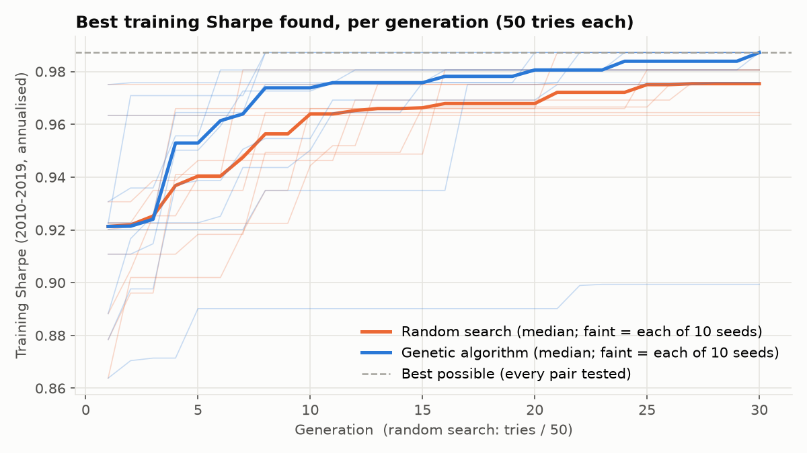
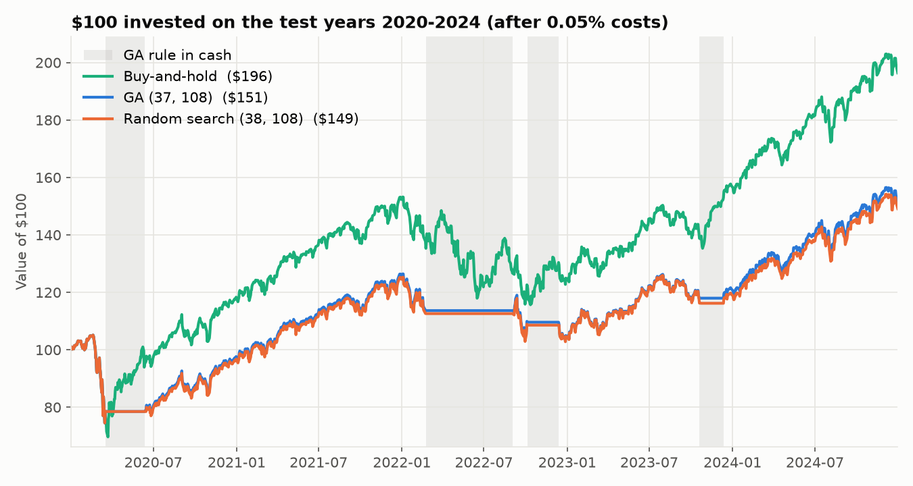
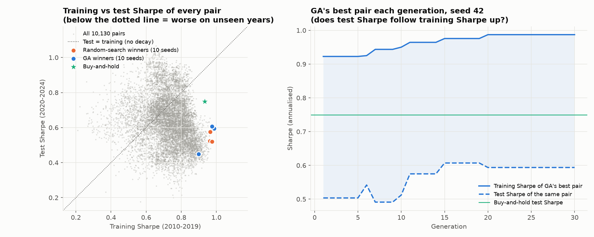
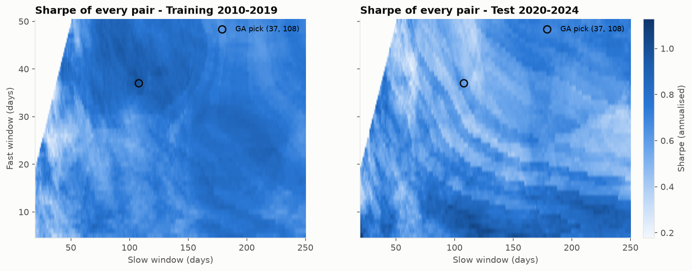
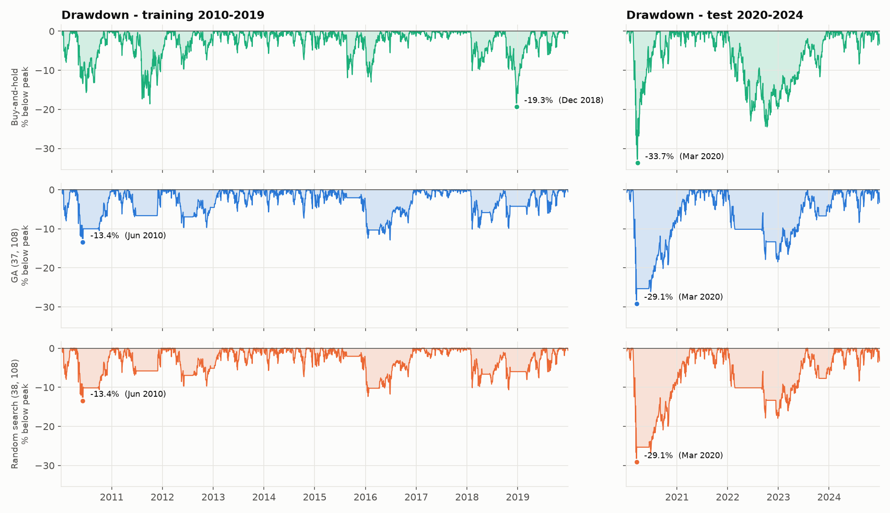

# Evolving a Trading Rule with a Genetic Algorithm

Can a genetic algorithm find trading-rule settings that keep working on years it has never seen, and can those settings beat simply buying and holding the market?

**Contents:** [1. Objective](#1-objective) · [2. Methodology](#2-methodology) · [3. Metrics](#3-metrics) · [4. Worked example by hand](#4-worked-example-by-hand) · [5. Results](#5-results) · [6. Code](#6-code) · [7. Limitations](#7-limitations-and-next-steps)

---

## 1. Objective

A simple trend-following rule has two settings. A **genetic algorithm (GA)**, a search method inspired by evolution, tunes them on 2010–2019 data. The project then answers three questions:

1. **Does the GA search well?** Does it find better settings than **random search** given the same number of tries?
2. **Do the settings hold up out of sample?** How much worse do they do on **2020–2024**, years the search never saw, scored exactly once?
3. **Was it overfitting?** How much of the training performance was a real pattern, and how much was fitted noise?

Everything is compared against **buy-and-hold**, a strategy that does no searching at all. A rule that cannot beat doing nothing is not useful.

Three things are kept separate throughout:

| | What it is | Here |
|---|---|---|
| **Trading rule** | Decides each day whether to own the stock or hold cash | Moving-average crossover on SPY |
| **Search method** | Tries many settings of the rule and keeps the best; it does not trade | Genetic algorithm, random search |
| **Benchmark** | The simple strategy everything must beat | Buy-and-hold SPY |

## 2. Methodology

### 2.1 The trading rule

A **moving average (MA)** is the average closing price over the last *N* days. The rule uses two of them:

- **Fast MA** over a short window, which reacts quickly.
- **Slow MA** over a long window, which reacts slowly.

**If the fast MA is above the slow MA, own SPY** (the price is trending up). **Otherwise hold cash**, which earns 0.

The only unknowns are the two window lengths, `fast` and `slow`. The search space is fast ∈ [5, 50] days and slow ∈ [20, 250] days, with fast < slow, which gives **10,130 possible pairs**. Finding the best pair is the whole job of the search methods.

### 2.2 Data and split

- **SPY** daily closes adjusted for dividends and splits, from Yahoo Finance. 2009 is downloaded only as warm-up, so a 250-day average already exists on the first trading day of 2010.
- **Training set, 2010–2019:** the only data the search methods ever see. It works like practising on old exam papers.
- **Test set, 2020–2024:** kept hidden and scored **once**, after the choices are frozen. It works like sitting a new exam.

### 2.3 Backtester

A backtester replays the rule on past prices and records what would have happened to the money. On each day *t*:

1. Daily return: $r_t = P_t / P_{t-1} - 1$.
2. The signal is computed at today's close, and the position applies from tomorrow: $\text{position}_t = \text{signal}_{t-1}$. This avoids **look-ahead bias**, meaning using a price you could not have known yet.
3. Strategy return: $\text{position}_t \cdot r_t - c \cdot |\text{position}_t - \text{position}_{t-1}|$, with transaction cost $c = 0.05\%$ charged on every buy or sell.

### 2.4 Search method 1: genetic algorithm

| Evolution term | Meaning in this project |
|---|---|
| Individual | One pair, e.g. (37, 108) |
| Population | 50 pairs |
| Fitness | The pair's annualised Sharpe ratio on **training data only** |
| Generation | One round of score → select → crossover → mutate → keep the best |

In each generation:

1. **Score** every pair.
2. **Elitism:** copy the 2 best pairs unchanged into the next generation, so the best solution is never lost.
3. **Tournament selection:** pick 2 pairs at random, and the one with the higher Sharpe becomes a parent.
4. **Crossover:** child 1 takes its fast value from parent 1 and its slow value from parent 2, and child 2 the other way round. This is how good parts of different solutions get combined.
5. **Mutation:** with 20% probability, nudge each number by a random step. This keeps the search exploring new areas.
6. **Repair:** keep the numbers in range and fast < slow.

The GA runs 30 generations of 50 pairs, which is **1,500 evaluations**.

### 2.5 Search method 2: random search (the control)

Draw 1,500 random valid pairs, which is **the same budget as the GA**, and keep the best. If random guessing does as well as the GA, the evolution is not adding anything.

### 2.6 Final exam and overfitting check

1. Run the GA and random search with seed 42. Their best pairs are **frozen**.
2. Score both pairs and buy-and-hold **once** on 2020–2024.
3. Check for overfitting. **Overfitting** means the rule matched random quirks of the past instead of a real pattern, like memorising old exam answers. Four checks:
   - **Train vs test Sharpe** for every one of the 10,130 pairs. A big drop, or a negative rank correlation, means overfitting.
   - **Per-generation test Sharpe** of the GA's best pair. Does it rise as the training Sharpe rises?
   - **10 seeds per method.** The GA is random, so if the runs land on very different "best" pairs, the result is mostly luck.
   - **Heatmaps** of Sharpe over the whole search space in each period. Did the good region stay in the same place?

These checks read test data only to *describe* choices that are already frozen. Nothing feeds back into a choice.

## 3. Metrics

| Metric | Meaning in plain words | Formula |
|---|---|---|
| **Daily return** | Change in price since yesterday | $r_t = P_t / P_{t-1} - 1$ |
| **Average return** | The typical daily gain | $\bar r = \frac{1}{n}\sum r_t$ |
| **Volatility** | How much returns jump around: the usual measure of risk | $\sigma = \sqrt{\frac{1}{n-1}\sum (r_t - \bar r)^2}$ |
| **Sharpe ratio** (main score) | Return earned per unit of risk; higher is better | $\text{Sharpe} = \frac{\bar r}{\sigma}\sqrt{252}$ (risk-free rate taken as 0) |
| **Max drawdown** (second check) | The biggest fall from a peak to a later low: how painful the strategy is to live through | $\min_t \left(\frac{\text{equity}_t}{\max_{s \le t} \text{equity}_s} - 1\right)$ |
| **CAGR** | Yearly growth rate of the money | $(\text{final}/\text{start})^{252/n} - 1$ |
| **Calmar ratio** | Yearly return per unit of worst-case pain | $\text{CAGR} / \lvert \text{max drawdown} \rvert$ |

**Why √252?** There are about 252 trading days in a year. Return grows in proportion to the number of days (×252), but risk grows only with its square root (×√252), because good and bad days partly cancel out. So the yearly Sharpe is $\frac{\bar r \cdot 252}{\sigma \sqrt{252}} = \text{daily Sharpe} \times \sqrt{252}$. This assumes daily returns are roughly independent of each other.

**Which matters more?** Sharpe is the main score, because a high-Sharpe strategy can be scaled up with leverage, while a weak one cannot be fixed that way. Max drawdown works as a **limit**, not a goal: a large fall can force investors out at the bottom. The rule of thumb here is to pick the highest Sharpe whose drawdown stays within −20%.

## 4. Worked example by hand

Before running on 15 years of data, every step above is done on **15 days of made-up prices** with tiny windows (2–6 days), so each number can be checked with a calculator. Transaction costs are left out to keep the arithmetic simple. Every number in this section is checked automatically by [`tests/test_worked_example.py`](tests/test_worked_example.py), so the code provably does the same maths.

| Day | 1 | 2 | 3 | 4 | 5 | 6 | 7 | 8 | 9 | 10 | 11 | 12 | 13 | 14 | 15 |
|---|---|---|---|---|---|---|---|---|---|---|---|---|---|---|---|
| Price ($) | 100 | 102 | 101 | 104 | 106 | 105 | 103 | 100 | 98 | 99 | 102 | 105 | 107 | 106 | 109 |

The price rises, falls in the middle, then rises again.

### 4.1 Backtesting one pair: fast = 2, slow = 4

On day 4, the fast MA is (101 + 104) / 2 = **102.5** and the slow MA is (100 + 102 + 101 + 104) / 4 = **101.75**. Fast is above slow, so the signal is 1. The signal at today's close becomes **tomorrow's** position.

| Day | Price | Daily return | Fast MA (2) | Slow MA (4) | Signal | Position | Strategy return |
|---|---|---|---|---|---|---|---|
| 1 | 100 | – | – | – | 0 | 0 | – |
| 2 | 102 | +2.00% | 101.0 | – | 0 | 0 | 0 |
| 3 | 101 | −0.98% | 101.5 | – | 0 | 0 | 0 |
| 4 | 104 | +2.97% | 102.5 | 101.75 | 1 | 0 | 0 |
| 5 | 106 | +1.92% | 105.0 | 103.25 | 1 | 1 | +1.92% |
| 6 | 105 | −0.94% | 105.5 | 104.00 | 1 | 1 | −0.94% |
| 7 | 103 | −1.90% | 104.0 | 104.50 | 0 | 1 | −1.90% |
| 8 | 100 | −2.91% | 101.5 | 103.50 | 0 | 0 | 0 |
| 9 | 98 | −2.00% | 99.0 | 101.50 | 0 | 0 | 0 |
| 10 | 99 | +1.02% | 98.5 | 100.00 | 0 | 0 | 0 |
| 11 | 102 | +3.03% | 100.5 | 99.75 | 1 | 0 | 0 |
| 12 | 105 | +2.94% | 103.5 | 101.00 | 1 | 1 | +2.94% |
| 13 | 107 | +1.90% | 106.0 | 103.25 | 1 | 1 | +1.90% |
| 14 | 106 | −0.93% | 106.5 | 105.00 | 1 | 1 | −0.93% |
| 15 | 109 | +2.83% | 107.5 | 106.75 | 1 | 1 | +2.83% |

The rule buys on day 5, sells after day 7 (missing the drops on days 8–9) and buys back on day 12.

**Sharpe ratio, step by step**

1. **Average:** the 14 strategy returns sum to 5.82%, so $\bar r$ = 5.82 / 14 = **0.416%**.
2. **Volatility:** the squared deviations, for example (1.92 − 0.416)² = 2.262, sum to 26.89. Dividing by 13 (that is, n − 1) gives 2.068, and √2.068 = **1.44%**.
3. **Daily Sharpe:** 0.416 / 1.44 = **0.288**. The yearly Sharpe is 0.288 × √252 = 4.58. That's unrealistically high, because 15 invented days are not real data.

**Max drawdown, step by step:** grow $100 by each strategy return.

| Day | 1–4 | 5 | 6 | 7 | 8–11 | 12 | 13 | 14 | 15 |
|---|---|---|---|---|---|---|---|---|---|
| Money ($) | 100 | **101.92** | 100.96 | **99.04** | 99.04 | 101.95 | 103.89 | 102.92 | 105.84 |

The peak is 101.92 (day 5) and the lowest point after it is 99.04 (day 7), so the drawdown is 99.04 / 101.92 − 1 = **−2.83%**.

### 4.2 The benchmark: buy-and-hold

Buy-and-hold owns the stock every day, so its strategy returns are just the daily returns. Average 0.639%, volatility 2.15%, so **Sharpe = 0.297**. The peak is 106 (day 5) and the low is 98 (day 9), so the **drawdown is −7.55%**. It ends at **$109**.

### 4.3 Every possible pair

With fast ∈ {1, 2, 3} and slow ∈ {4, 5, 6} there are only 9 pairs (fast = 1 just means today's price). Daily Sharpe for each:

| | Slow 4 | Slow 5 | Slow 6 |
|---|---|---|---|
| **Fast 1** | **0.288** | 0.202 | 0.259 |
| **Fast 2** | **0.288** | 0.043 | −0.053 |
| **Fast 3** | −0.002 | −0.100 | −0.053 |

Here you could simply test all 9. The real project has 10,130 pairs, which is why a search method is needed. For a fair comparison, each method below gets only a few tries.

### 4.4 Random search

Pick pairs at random and keep the best: (2, 5) → 0.043, (3, 6) → −0.053, **(1, 6) → 0.259**, (3, 4) → −0.002. The best so far is (1, 6). Whether later picks find the top pair is left entirely to luck.

### 4.5 Genetic algorithm, one generation

**Generation 1** has 4 random pairs: A = (3, 5) → −0.100, B = (2, 6) → −0.053, **C = (1, 5) → 0.202**, D = (3, 4) → −0.002.

- **Selection (tournament):** A vs C → C wins. B vs D → D wins. The parents are C = (1, 5) and D = (3, 4).
- **Crossover:** child 1 = fast from C + slow from D = **(1, 4)**. Child 2 = fast from D + slow from C = (3, 5).
- **Mutation:** child 2's fast value is nudged from 3 to 2, giving (2, 5).
- **Elitism:** the best 2, C and D, are copied straight into the next generation.

**Generation 2** contains (1, 5) → 0.202 and (3, 4) → −0.002 (kept by elitism), **(1, 4) → 0.288** (from crossover), and (2, 5) → 0.043 (crossover plus mutation).

The best Sharpe jumped from 0.202 to **0.288, the best possible pair**. It happened because crossover combined C's good fast value with D's good slow value. That is the core idea of a GA, though it will not always beat random search, which is why the real project runs both 10 times.

### 4.6 What the toy example teaches

| Strategy | Final money | Daily Sharpe | Max drawdown |
|---|---|---|---|
| Buy-and-hold | **$109.00** | **0.297** | −7.55% |
| GA's best (1, 4) | $105.84 | 0.288 | −2.83% |
| Random search's best (1, 6) | $104.83 | 0.259 | **−1.90%** |

Buy-and-hold made the most money, because the market rose overall and the strategies missed some gains while in cash. The strategies were much less painful to hold, though, because they stepped aside during the fall. No strategy wins on every measure, which is why both Sharpe and drawdown are checked.

## 5. Results

### 5.1 Final exam: test set scored once

| Strategy | Train Sharpe | Test Sharpe | Sharpe drop | Train Max DD | Test Max DD | Test CAGR | Test Calmar | $100 → |
|---|---|---|---|---|---|---|---|---|
| Buy-and-hold | 0.93 | **0.75** | 0.18 | −19.3% | −33.7% | 14.5% | 0.43 | **$196** |
| GA (37, 108) | **0.99** | 0.59 | 0.39 | −13.4% | **−29.1%** | 8.7% | 0.30 | $151 |
| Random search (38, 108) | 0.96 | 0.57 | 0.39 | −13.4% | **−29.1%** | 8.3% | 0.29 | $149 |

Sharpe ratios are annualised with a 0% risk-free rate; the full table is in `results/results_table.csv`. No strategy kept its test drawdown within the −20% limit, because the March 2020 COVID-19 crash fell faster than any 108-day average could react.

### 5.2 What the experiment shows

1. **The GA is a better optimiser than random search.** With the same 1,500 evaluations, the GA found the best training pair in the whole grid, (37, 108), in **6 of 10 seeds**. Random search found it in 1 of 10. The GA also tested only ~600 distinct pairs, because evolution concentrates its tries where the scores are good.
2. **Being a better optimiser did not help out of sample.** Both methods lost about 0.39 of Sharpe on the test years, and both ended below buy-and-hold. The extra training Sharpe the GA found was fitted noise.
3. **Training rank does not predict test rank.** Across all 10,130 pairs, the rank correlation between training and test Sharpe is **−0.27**. Picking the training winner selects pairs from the bottom-right of the cloud, which is the definition of overfitting. The heatmaps show why: the best region in training (fast ≈ 35–45, slow ≈ 100–130) is a weak region in 2020–2024, and the best test pairs moved to fast < 15.
4. **Over the generations, test Sharpe followed training Sharpe up only a little, from 0.50 to 0.59 (seed 42).** The gap between the two stayed around 0.4, and the test Sharpe never reached buy-and-hold.
5. **Luck check.** 9 of 10 GA seeds converged to the same small neighbourhood, (37–38, 106–108). Seed 47 got stuck in a local optimum at (23, 220), with training Sharpe 0.90 and test Sharpe 0.45. The answer is mostly stable, but one run in ten would have given a noticeably worse rule.
6. **The drawdown protection was real but partial.** In the 2022 bear market, the GA rule's worst fall was −18.5%, against −24.5% for buy-and-hold, because it stepped into cash. In March 2020 the rule still fell 29%. It then sat in cash through the rebound and took until April 2021 to recover its peak, while buy-and-hold recovered by August 2020.
7. **Buy-and-hold is a hard benchmark.** Its training Sharpe of 0.93 is already higher than 99.4% of all pairs. Only 20% of pairs beat it on test, and nothing in the training data tells you in advance which 20%.

> **In one line:** The GA tuned the rule well, 0.99 training Sharpe versus 0.96 for random search, finding the global optimum 6 times out of 10. Out of sample, the Sharpe fell to 0.59 against 0.75 for buy-and-hold, because the parameter region that worked in 2010–2019 stopped working in 2020–2024. Training and test Sharpe are negatively rank-correlated across the search space. The rule cut the drawdown from −33.7% to −29.1%, a smaller cushion than the return it gave up.

### 5.3 Charts

**Search quality:** best training Sharpe found per generation. The GA reaches the best possible pair, and random search mostly does not.



**Final exam:** $100 invested over the test years. Grey bands mark when the GA rule was in cash.



**Overfitting check.** Left: training vs test Sharpe for every pair, where points below the dotted line did worse on unseen years. Right: the GA's best pair each generation, training vs test.



**Why it decayed:** Sharpe of every pair in each period, on the same colour scale.



**How painful each strategy was:** percent below the previous peak, day by day.



## 6. Code

| Step | File | What it does |
|---|---|---|
| Settings | `config.py` | Every setting: dates, cost, search ranges, GA sizes, seeds |
| Data | `data.py` | Downloads SPY and caches it to `data/SPY.csv`, so every run uses identical prices |
| Rule, backtest, metrics | `backtest.py` | Signal → shift one day → returns minus costs. Sharpe, drawdown, CAGR, Calmar, buy-and-hold, full Sharpe grid |
| Genetic algorithm | `ga.py` | Tournament selection, crossover, mutation, elitism, repair |
| Random search | `random_search.py` | 1,500 random pairs, best kept |
| Experiment | `main.py` | Search on training data → freeze → score once on test → overfitting diagnostics → charts |
| Charts | `charts.py` | The five PNGs above |
| Tests | `tests/test_worked_example.py` | Reproduces every number in section 4 |

```bash
python3 -m venv .venv && source .venv/bin/activate
pip install -r requirements.txt
python main.py           # ~15 s, writes everything to results/
python -m pytest tests   # checks the worked example
```

## 7. Limitations and next steps

- **One asset, one split.** A single 5-year test window, dominated by COVID-19 and 2022, is one draw. **Walk-forward testing** (train 3 years, test the next 1, roll forward) would show whether the decay is systematic.
- **Execution assumptions.** Trades happen at the close the signal was computed on, with no slippage, and cash earns 0% (rates were about 5% in 2023–24, which would help the cash periods).
- **A small search space.** With only two parameters an exhaustive grid is feasible, so the GA here is a demonstration. GAs earn their keep on larger spaces, for example adding an RSI filter or a stop-loss, or **NSGA-II** to optimise Sharpe and drawdown together.

*For learning purposes only; not investment advice. The worked-example prices are invented for illustration.*
